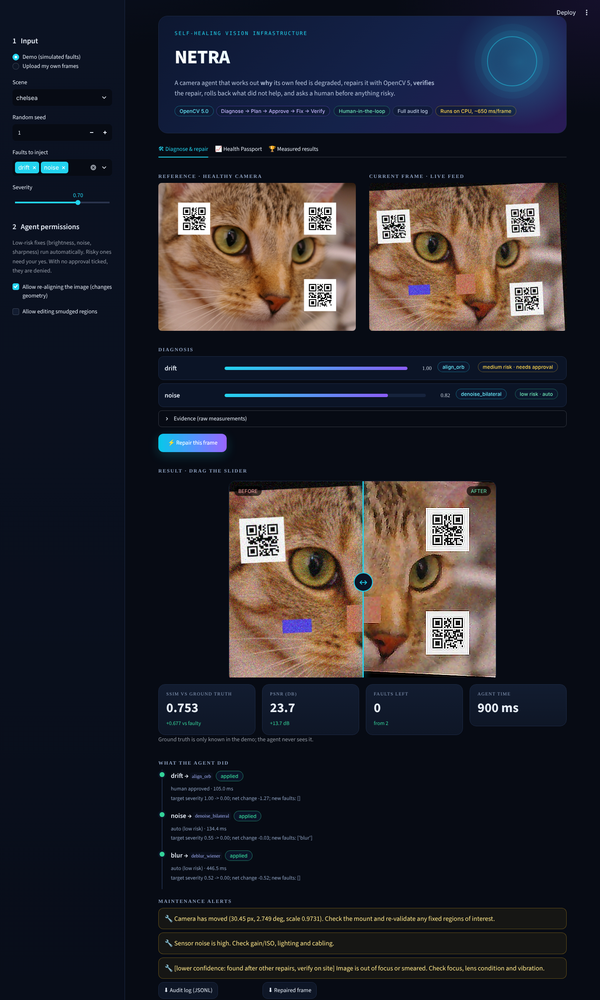
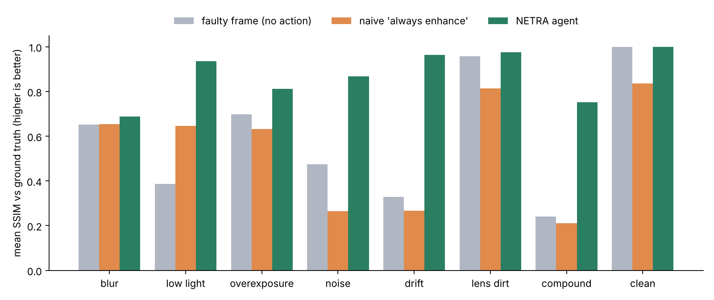
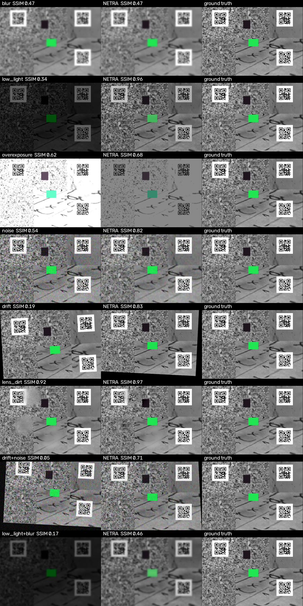

# NETRA - a self-healing camera agent (OpenCV 5)

Vision systems fail silently when the *camera* degrades: a lens gets smudged, the mount shifts, the
light drops, focus drifts. The model downstream keeps running and keeps being wrong. NETRA is an agent
that watches a camera feed, works out **why** it is degraded, picks an OpenCV repair, **checks that the
repair actually helped**, rolls it back if not, asks a human before risky changes, and tells maintenance
what to look at.

```
frame + reference --> DIAGNOSE --> PLAN --> APPROVAL GATE --> FIX --> VERIFY --+--> keep (applied / partial)
 (OpenCV 5 tools)     6 fault      rule or    low risk: auto    tool    re-diagnose  +--> roll back, try next tool
                      detectors    LLM        medium: human     registry + net-severity +--> escalate to a human
                                   proposes   (default: deny)            check
                                       every step is written to a JSONL audit log
```



## Results (measured, reproducible)

Final numbers are on **192 faulty + 16 clean frames from 8 fresh scenes** that were never used for tuning
(random collages; see "Evaluation protocol"). Ground truth is known to the evaluator and never to the agent.

| | faulty frame | naive "always enhance" | **NETRA** |
|---|---|---|---|
| Mean SSIM vs ground truth, all faulty frames | 0.498 | 0.462 | **0.843** |
| Mean PSNR (dB) | 14.2 | 12.3 | **22.9** |
| Frames made better / worse (SSIM, +-0.01) | - | 25% / **71%** | **88% / 0%** |
| Clean frames: SSIM after processing | 1.000 | 0.836 | **1.000** (untouched) |
| False alarms on clean frames | - | - | **0 / 16** |

By fault (mean SSIM: faulty / naive / NETRA):

| fault | faulty | naive | NETRA | note |
|---|---|---|---|---|
| low light | 0.387 | 0.645 | **0.935** | |
| camera drift | 0.329 | 0.267 | **0.963** | ORB+RANSAC alignment, ECC fallback |
| noise | 0.475 | 0.265 | **0.868** | |
| overexposure | 0.697 | 0.633 | **0.812** | clipped highlights cannot be recovered |
| lens dirt | 0.958 | 0.813 | **0.975** | improved in 71% of cases |
| compound (2 faults) | 0.241 | 0.210 | **0.751** | |
| **blur** | 0.653 | 0.654 | **0.688** | **diagnosed correctly but mostly not repairable** |

Diagnosis (first pass): single-fault exact match **96.5%**, target-fault recall **98.6%**. Low light,
overexposure, noise and drift: precision and recall 1.00. Blur: precision 0.87 (every false positive
co-occurs with drift on textured scenes, where resampling softens the image), recall 1.00. Lens dirt:
precision 1.00, recall 0.69 on the first pass (dirt is judged last by design, so in compound cases it
appears after other fixes; run-level recall 0.94, run-level precision 0.67).

Downstream (3 QR codes per frame, fraction decoded): anywhere in the frame 0.64 -> **0.71**; in
fixed regions of interest, as in real analytics, 0.56 -> **0.66** (upper bound 0.88 on clean frames).
Cost: **about 650 ms per frame** on a 2-vCPU cloud sandbox at 640x480, no GPU. 19.8% of faulty frames are
escalated to a human because the agent could not clearly fix them.




### Honest weak spots
* **Blur is not solved.** Wiener deconvolution recovers SSIM only slightly and QR decoding stays near 0.
  The agent knows this: it rolls back fixes that do not help and flags the frame for a human.
* **Overexposure** lowers error but cannot restore what clipping destroyed. Low-light QR decoding in
  fixed regions got slightly *worse* (0.97 -> 0.90) even though SSIM improved a lot.
* **Lens-dirt alerts found after other repairs have about 0.67 precision**, so they are labelled
  "lower confidence, verify on site". Dirt needs texture in the reference: on flat scenes it cannot be seen.
* **Everything is judged against a reference frame** from the healthy camera, and the evaluation uses a
  fixed camera and simulated faults. There is no real-camera validation yet.
* The dirt fix (`dehaze_local`) and the smudge simulator share a similar model (contrast loss + haze), so
  that result is optimistic for real smudges. Inpainting was tested and *hurt* in 12/12 calibration cases,
  which is why the verifier rejects it.

## Beyond one frame: Health Passport and the downstream-task guard

**Health Passport** (`netra/passport.py`). Every run records its diagnosis metrics (also values still below
the fault limits) per camera. A Theil-Sen trend with a Mann-Kendall significance test (p < 0.001) over
10/20/30-day windows (shortest significant one wins) forecasts *when* the camera will cross a fault limit:
"mount creeping, will exceed 3 px in about 9 days; plan maintenance". Evaluated on simulated slow
degradations (one frame per day, 50 days, 6 fresh scenes x 5 processes + 6 stable cameras; ground truth =
first day the detector itself flags the fault two days running). Window choice was made on calibration
scenes only; the first linear-only version is kept in `results/forecast_v1_linear/`.

| process | forecast issued on day 20 (alerted, mean abs. error) | day 30 |
|---|---|---|
| creeping drift | 6/6, 1.8 days | 6/6, 1.1 days |
| rising noise | 4/6, 2.2 days | 6/6, 1.1 days |
| focus loss | 0/6 (too early to see) | 6/6, 2.3 days (v1 linear: 0/6) |
| dimming | 3/6, 9.1 days | 6/6, 4.9 days |
| dirt build-up | 5/6, 16.1 days | not enough cases |
| stable cameras | 0 false alerts in 24 checks | |

Limits: simulated degradations with constant rates; early dirt forecasts are poor (error about 16 days);
focus loss is flat until it accelerates, so it is only caught around day 30. Real cameras will be messier.

**Downstream-task guard** (`Agent(task=fn)`). Image-quality metrics can say "better" while the user's task gets
worse (low light: SSIM up, QR decoding in fixed regions 0.97 -> 0.90). If a `task` score is supplied, any
repair that lowers it is rolled back. Fresh scenes, 144 single-fault frames, task = QR codes decoded in
fixed regions:

| | faulty | NETRA | NETRA + task guard |
|---|---|---|---|
| task score | 0.648 | 0.720 | **0.787** |
| frames where the task got worse than the input | - | 17 | **0** |
| SSIM vs ground truth | - | **0.870** | 0.829 |

The guard trades some image fidelity for the task. It needs a task score at run time (here the expected QR
payloads are known; a real deployer must have an equivalent signal). Reproduce: `python -m netra.eval_taskguard`,
`python -m netra.eval_forecast`.

## Provenance and a real-camera mode

* **Tamper-evident audit log.** Each event stores the SHA-256 of the previous one, so editing, deleting or
  reordering any past entry breaks the chain (`python -m netra.provenance audit.jsonl receipt.json repaired.png`).
  A **repair receipt** binds the original frame, the repaired frame and the chain head together, so a repaired
  image cannot be passed off as the original. It is integrity evidence, not a digital signature: someone able to
  rewrite the whole log and receipt could forge both; sign or anchor the head hash for stronger proof.
* **Live webcam mode** in the UI: shoot a healthy reference with your own camera, degrade it for real (smudge,
  dim the room, move it) and shoot again. This is a manual demo, **not a validated evaluation** on real cameras.

## Fleet queue and shareable reports

* **Fleet tab** (`netra/fleet.py`): ranks many cameras into one maintenance queue from their Health Passports
  (already past a limit, then fewest days to the forecast limit, then health score). The six cameras are
  **simulated**; the ranking logic is real. Rebuild the cache with `python -m netra.fleet --build`.
* **HTML health report** (`netra/report_html.py`): one self-contained file per repair (before/after, diagnosis,
  verified steps, alerts, forecast, provenance hashes) that can be sent to a maintenance team or printed.

## How it works

| fault | detector (OpenCV 5) | repair tools, in the order tried | risk |
|---|---|---|---|
| drift | ORB + ratio test + RANSAC `estimateAffinePartial2D` | `warpAffine` (Lanczos) / coarse-to-fine `findTransformECC` | **medium** |
| lens dirt | block-wise Laplacian-energy ratio vs reference, median-normalised, connected components | local contrast restoration / `inpaint` | **medium** |
| low light, overexposure | luminance ratio, clipped-pixel excess | CLAHE+gamma, LUT gamma, linear gain | low |
| noise | Immerkaer estimate / image std, excess over reference | bilateral filter, `fastNlMeansDenoisingColored` | low |
| blur | normalised Laplacian-energy ratio | Wiener deconvolution with `cv2.dft` (PSF width searched against the reference), unsharp mask | low |

* **Verification:** after every tool the frame is re-diagnosed. The target fault must drop to <=70%
  of its severity ("applied") or <=85% ("partial", the fault stays open), and the total severity of the
  frame must not rise. Otherwise the step is rolled back and the next tool is tried.
* **Approval gate:** `auto_low` (default) runs low-risk tools alone; medium-risk tools (geometry change,
  regional edits) need a human. **No approver connected means denied.** `ask_all` and `auto_all` also exist.
* **Failure handling:** a crashing tool is logged and skipped; there is a step cap and a time budget; the
  original frame is never modified.
* **Observability:** JSONL audit log with run id, policy, every diagnosis, tool, parameters, decision,
  before/after severity, latency and verdict. The UI lets you download it.
* **Planner:** `RulePlanner` (default, offline, deterministic) or `LLMPlanner(llm_call)` for any provider.
  The LLM only *proposes*: its output is validated against the live diagnosis and the fixed tool registry
  (invented tools are ignored, garbage falls back to the rules) and still goes through the approval gate
  and verification. Tested with mock models only; no real LLM was called.
* **Maintenance alerts** give the likely physical cause ("smudge covers 9% of the view: schedule a lens
  cleaning", "camera moved 24 px / 2.5 deg: re-validate regions of interest").

## Evaluation protocol (what was tuned on what)

1. **Calibration scenes** (4 photos): thresholds and tool parameters (Wiener K, bilateral strength, tool order).
2. **First test round** (8 other photos, kept in `results/v1_test_before_dirt_fix/`):
   SSIM 0.512 / 0.472 / 0.844 (faulty / naive / NETRA). It exposed a real flaw: **73 false "lens dirt" alarms
   (precision 0.27)** after exposure repairs, because clipped regions look like smudges. A first idea
   (log-domain contrast) made it worse and was discarded. The fix that worked was to exclude pixels the
   sensor clipped or crushed in the *original* frame (calibration: 5/20 -> 0/20 false alarms).
3. **Fresh scenes** (8 random collages, including photos never used before): the final numbers above.
   Because step 2 influenced the fix, only this round is reported as the result.

Faults are simulated (blur, low light, overexposure, noise, drift, lens dirt) at three severities, plus six
compound pairs and clean frames. Scenes are photos bundled with scikit-image plus three QR codes (check
scikit-image's data notes for image licences). To make the reference differ from the live frame, each live
frame has +-8% brightness and 2-3 objects that were not in the reference.

## Run it

```bash
pip install -r requirements.txt pandas pytest
python -m pytest -q                                   # 28 tests
streamlit run app.py                                  # UI: inject faults or upload frames, approve risky fixes
python -m netra.cli --ref ref.png --frame cam.png --out fixed.png [--yes-risky]
python -m netra.evaluate --out results/final_fresh    # about 3 min on 2 cores, deterministic seeds
python -m netra.report results/final_fresh            # figures + gallery
```

```python
from netra.agent import Agent
agent = Agent(reference_bgr, policy="auto_low", log_path="audit.jsonl")
result = agent.run(frame_bgr, approver=lambda step: input(f"allow {step['tool']}? ") == "y")
result.output, result.alerts, result.unresolved
```

## Responsible use
NETRA only measures image quality. It does not detect or identify people, faces or number plates, and the
demo data are generic photos. It never overwrites the source frame, never changes geometry or edits regions
without approval, and logs every action. On real surveillance cameras the deployer remains responsible for
privacy and consent, and repaired frames must not be presented as original evidence (the audit log records
every modification).

## Not done / not tested
* **No AWS deployment was made** (no AWS account). `deploy/` holds an *untested* EC2/Graviton script and a
  `Dockerfile` that could **not** be built here (no Docker daemon). What was verified: installing from
  `requirements.txt` into a clean virtualenv with OpenCV 5.0.0, and the Streamlit server health check.
* **No COOL / Graviton claims.** No Bedrock or other LLM was used.
* No real-camera footage, no video-stream handling. Passport results use simulated slow degradation only.

## Layout
`netra/` scenes, faults (simulator), diagnose, fixes, agent, passport, timeline, evaluate, eval_forecast, eval_taskguard, report, cli - `app.py` UI -
`tests/` - `results/` per-run CSV, JSON summaries, figures - `deploy/` untested AWS scripts - `docs/` submission kit
